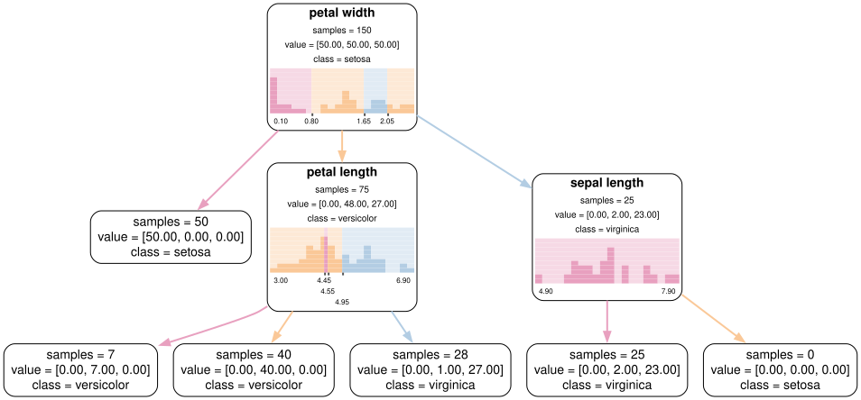

Plotting & Export
=================

.. currentmodule:: sgtlearn

Visualize a fitted SGT, or export it as indented text rules or Graphviz DOT.

plot_tree
---------

.. autofunction:: plot_tree

When a fitted estimator contains Shape²CART nodes, the same ``plot_tree`` API
renders the exact pair routing heatmap. Continuous/categorical combinations
use the corresponding rectangle or category-matrix layout, with independent
missing-value margins (and a both-missing corner) and one color for each of the
``K`` outer partitions. Passing ``X`` adds top/right marginal histograms and
shows missing margins only when the corresponding node data contain missing
values. Continuous axes label only thresholds where the final partition
changes, formatted with ``precision``; categorical axes retain category labels.
See :doc:`../tutorials/bivariate-branching` for a worked example.

export_text
-----------

.. autofunction:: export_text

Each child line describes the inputs routed to that child, so the rules
reproduce ``predict`` up to the displayed ``decimals``. Like ``predict``, they
apply to ``X`` rounded to float32: ``1.5 + 1e-9`` rounds to ``1.5`` and follows
``x <= 1.50`` below.

.. code-block:: text

   |--- x <= 1.50 or x is missing
   |   |--- value: 0.00
   |--- x > 1.50
   |   |--- value: 1.00

export_graphviz
---------------

.. autofunction:: export_graphviz

``export_graphviz`` draws the same panels as ``plot_tree`` with Graphviz
HTML-like labels. Each internal node shows its shape function, shaded by the
child each region routes to, and with ``X`` a histogram of the samples that
reach it (a heatmap with marginal histograms for pair nodes). Edges are colored
by child; hover over an edge in a rendered SVG to see the ``export_text`` rule
for that child. The output is plain DOT text and needs no extra package. To
render it, install the ``graphviz`` Python package and the Graphviz binaries:

.. code-block:: python

   import graphviz
   from sklearn.datasets import load_iris
   from sgtlearn import SGTClassifier, export_graphviz

   iris = load_iris()
   model = SGTClassifier(num_partitions=3, max_depth=2, random_state=0)
   model.fit(iris.data, iris.target)
   dot = export_graphviz(
       model,
       X=iris.data,
       feature_names=[n.replace(" (cm)", "") for n in iris.feature_names],
       class_names=iris.target_names,
   )
   graphviz.Source(dot).render("tree", format="svg")

         histogram in each internal node.
