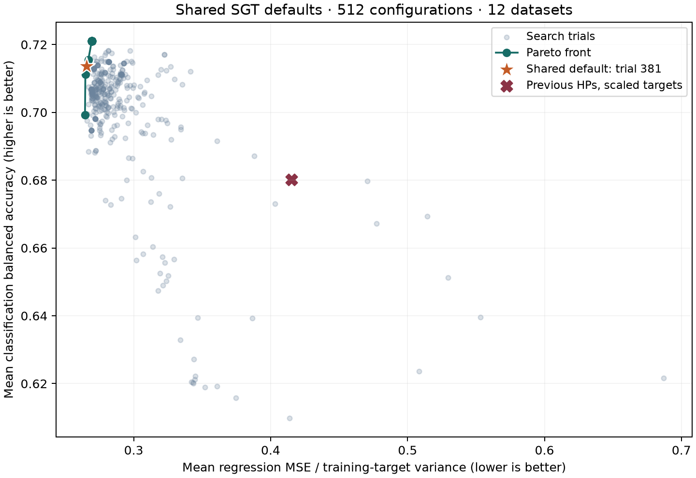

# Shared SGT defaults: expanded TabArena study

Date: 2026-10-26. Branch: `codex/feat-29-tuning-defaults`. Related ticket: [#29](https://github.com/optimal-uoft/sgtlearn/issues/29).

**Decision:** use trial 381 as the shared classifier/regressor starting point, with production-default overrides `pairwise_candidates=0` and `tao_n_runs=0`. Bivariate splits and TAO remain opt-in; `0.5` is the study-recommended bivariate starting value. The expanded study completed 512 trials (325 distinct parameter dictionaries), with 36 validation fits per trial and no failed trials. The fixed selection rule chose the normalized compromise on the classification–regression Pareto front. Reserved tests show a regression improvement and a classification tradeoff for the measured configuration with pairs enabled and one TAO sweep; these scores do not measure the final univariate, ShapeCART-only defaults.



## Study-selected configuration

```python
{
    "max_depth": 4,
    "max_leaf_nodes": None,
    "num_partitions": 7,
    "inner_max_depth": None,
    "inner_max_leaf_nodes": 4,
    "min_samples_leaf": 4,
    "inner_min_samples_leaf": 13,
    "min_impurity_decrease": 1.0,
    "inner_min_impurity_decrease": 0.01,
    "coordinate_descent_max_iters": 5,
    "coordinate_descent_patience": 5,
    "pairwise_candidates": 0.5,
    "pairwise_penalty": 0.0,
    "branching_penalty": 0.0,
    "max_features": None,
    "tao_n_runs": 1,
    "tao_lambda": 0.0001,
    "tao_pair_scale": 2.0
}
```

Public tree and forest constructors use these settings except `pairwise_candidates=0` and `tao_n_runs=0`. Ordinary fitting runs ShapeCART; bivariate routing and TAO are explicit opt-ins. To reproduce the measured configuration, enable pairs at `0.5` and one TAO sweep. Removing TAO-specific estimator parameters is tracked separately in [#93](https://github.com/optimal-uoft/sgtlearn/issues/93) for v1.0.0. Existing forest-specific defaults follow sklearn: 100 trees, bootstrap on, all rows per bootstrap sample, `max_features="sqrt"` for classification and `1.0` for regression, `n_jobs=None`, `random_state=None`, and `verbose=0`. **No forest performance claim is supported by this experiment.**

## Protocol and reproducibility

The search uses six classification and six regression datasets from [TabArena v0.1 metadata](https://github.com/autogluon/tabarena/blob/main/packages/tabarena/src/tabarena/benchmark/task/metadata/sources/data/TabArena-v0.1_tasks_metadata.csv). Data are loaded through the [official minimal OpenML approach](https://github.com/autogluon/tabarena/blob/main/examples/advanced/run_get_tabarena_datasets_from_openml.py), without AutoGluon. This is a custom small-panel study, not a full TabArena leaderboard run.

| Dataset | Task | OpenML task |
|---|---|---:|
| credit-g | classification | 363626 |
| diabetes | classification | 363629 |
| maternal_health_risk | classification | 363685 |
| airfoil_self_noise | regression | 363612 |
| concrete_compressive_strength | regression | 363625 |
| blood-transfusion-service-center | classification | 363621 |
| website_phishing | classification | 363707 |
| churn | classification | 363623 |
| QSAR_fish_toxicity | regression | 363698 |
| healthcare_insurance_expenses | regression | 363675 |
| Another-Dataset-on-used-Fiat-500 | regression | 363615 |
| miami_housing | regression | 363686 |

For each dataset, official repeat 0 / outer fold 0 supplies the training and reserved-test rows. The objective uses three fixed inner folds within that training set. Classification folds are stratified; regression folds are shuffled. Seed 42 is fixed. One-hot vocabularies are fitted independently on inner-training rows and preserve logical feature groups. Native feature missing-value handling is retained. Regression target standardization is fitted within each training fold, using sample weights when supplied; these datasets use uniform weights. No objective reads outer-test labels or the two additional holdout datasets.

The minimized objectives are (1) the equally weighted mean of `1 - balanced_accuracy` across the six classification datasets, and (2) the equally weighted mean of `MSE / training_target_variance` across the six regression datasets. Dataset size does not affect its weight. Raw MSE is retained per regression dataset.

Optuna TPE uses 64 startup trials, seed 42, and warm starts from the preliminary five-dataset Pareto candidates. Every warm-start candidate is evaluated anew on all 12 datasets. The search budget was up to 512 trials or ten hours; all 512 completed in approximately six hours five minutes. Each configuration has a ten-minute limit. The deliberately extreme rich pilot exceeded that limit; no search trial did. Runtime is recorded but is not an objective.

The Pareto front contains five distinct objective points (repeated trials can have the same point). Normalize each objective by its range **on the front**, subtract the coordinate-wise ideal, then minimize Euclidean distance; break ties by trial number. The rule was agreed before viewing final test outcomes. Trial 381 was selected before confirmation; test results did not trigger reselection.

| Distinct front trial | Mean balanced accuracy | Mean normalized MSE |
|---:|---:|---:|
| 264 | 0.699278 | 0.264426 |
| 368 | 0.711165 | 0.264691 |
| 376 | 0.715504 | 0.266827 |
| 381 (selected) | 0.713675 | 0.265693 |
| 397 | 0.721089 | 0.269393 |

Exact package versions, source hashes, dataset cache hashes, dataset/task identifiers, and the starting Git revision are recorded in [manifest.json](../../benchmarks/results/tuning-29-expanded/manifest.json). Exact source files used by the search are preserved in [search-sources.zip](../../benchmarks/results/tuning-29-expanded/search-sources.zip). The local NPZ caches include exact split row indices and are ignored by Git; OpenML also caches the source data. The native C++ source was unchanged from the recorded revision.

```bash
pip install -e '.[tune]' openml pandas
python -m benchmarks.tune_defaults --output benchmarks/results/new-study --pilot
python -m benchmarks.tune_defaults --output benchmarks/results/new-study --trials 512 --hours 10
python -m benchmarks.analyze_tuning --output benchmarks/results/new-study
python -m benchmarks.tune_defaults --output benchmarks/results/new-study --confirm
```

Use a new output directory when sources or datasets change. The study rejects mismatched manifests instead of combining incompatible objectives. To reproduce the precise recorded source hashes, use the source archive and recorded package versions. The example above starts afresh; the expanded run additionally used `--warm-start benchmarks/results/tuning-29`.

## Reserved test outcomes

The comparison is against **previous tree hyperparameters with the new target scaling and fixed `tao_lambda=1e-4`**, not against an unchanged released binary. This isolates the hyperparameter choice after the requested scaling change. Only one official outer test split is evaluated per dataset.

| Dataset | Metric | Selected | Previous HPs |
|---|---|---:|---:|
| credit-g | Balanced accuracy ↑ | 0.5645 | 0.5718 |
| diabetes | Balanced accuracy ↑ | 0.6890 | 0.6622 |
| maternal_health_risk | Balanced accuracy ↑ | 0.7439 | 0.8404 |
| airfoil_self_noise | MSE ↓ | 11.1867 | 15.4244 |
| concrete_compressive_strength | MSE ↓ | 61.7783 | 78.3302 |
| blood-transfusion-service-center | Balanced accuracy ↑ | 0.6013 | 0.6118 |
| website_phishing | Balanced accuracy ↑ | 0.8592 | 0.9057 |
| churn | Balanced accuracy ↑ | 0.8617 | 0.7916 |
| QSAR_fish_toxicity | MSE ↓ | 1.2256 | 1.7970 |
| healthcare_insurance_expenses | MSE ↓ | 18,494,520.4581 | 50,519,229.4191 |
| Another-Dataset-on-used-Fiat-500 | MSE ↓ | 717,889.8321 | 1,073,532.8658 |
| miami_housing | MSE ↓ | 18,614,268,411.1046 | 25,849,391,741.8513 |
| qsar-biodeg **(unseen dataset)** | Balanced accuracy ↑ | 0.7860 | 0.6783 |
| wine_quality **(unseen dataset)** | MSE ↓ | 0.5140 | 0.7969 |

Across the six search-panel classification tests, mean balanced accuracy changes from 0.7306 to 0.7199 (-1.06 percentage points). Four classification datasets regress, notably maternal health risk and website phishing, while diabetes and churn improve. Across the six regression tests, mean normalized MSE falls from 0.3932 to 0.2592 (34.1% lower), with all six improving.

Both previously excluded datasets improve: QSAR biodegradation balanced accuracy rises from 0.6783 to 0.7860; wine-quality MSE falls from 0.7969 to 0.5140. These two outcomes are encouraging but too few to establish broad generalization.

## Which parameters deserve tuning?

Global fANOVA estimates are observational summaries of the sampled study. Classification importance is dominated by outer impurity cost (0.599), outer minimum leaf size (0.150), and then TAO sweeps (0.056) and outer depth (0.049). Regression importance is dominated by inner minimum leaf size (0.581), outer impurity cost (0.216), and inner leaf count (0.094). These fractions depend on the sampled distributions, interactions, and repeated trials; they are not causal effects or confidence levels.

Controlled one-parameter sweeps around trial 381 supplement those estimates. They keep all other settings fixed and reuse the three inner folds, never the test sets. Their ranges are local and can miss interactions. A tested value is called promising when it is within one balanced-accuracy percentage point of that sweep’s best value, or within 5% of its best normalized regression MSE.

| Priority | Parameter | Public suggested range | Evidence / interpretation |
|---|---|---|---|
| First | `min_impurity_decrease` | `{0, .01, .1, 1, 10}` | Strong classification and regression effect; diabetes can favor stronger pruning, so retain 10. |
| First | `min_samples_leaf` | integer 1–32, log | Strong regularization effect; small and imbalanced classification tasks need different settings. |
| First | `inner_min_samples_leaf` | integer 1–32, log | Largest regression importance; dataset-specific preferred sizes vary markedly. |
| First | `inner_max_leaf_nodes` | integer 2–64, log | Broad search covered 2–256. Local curves plateau at large counts; 64 retains that plateau while reducing cost. |
| Next | `inner_min_impurity_decrease` | `{0, .001, .01, .1}` | Especially important for churn; 0.1 can hurt other tasks. |
| Next | `pairwise_candidates` | `{0, .25, .5, 1, 2}` | Disabling interactions harms several tasks; higher budgets cost more and are not universally better. |
| Next | `max_depth` | integer 4–10 | Deeper trees help airfoil and churn locally; shallower trees suit several small classification tasks. |
| Next | `num_partitions` | integer 2–8 | Binary-only branching can lose useful structure; values above effective inner-bin count often plateau. |
| Secondary | `pairwise_penalty` | `{0, .01, .1, 1}` | Low global importance, but some local changes matter; omit when pairs are disabled. |
| Secondary | `branching_penalty` | `{0, .01, .1, 1}` | Can help concrete or credit-g locally; omit for binary-only branching. |
| Fix initially | CD iterations / patience | `5 / 5` | Raising either gives no local improvement from the selected configuration. |
| Opt-in refinement | TAO sweeps / pair multiplier | `1 / 2` when enabled | More sweeps change churn by at most about 0.18 percentage points locally; pair-multiplier effects are tiny here. Ordinary fitting leaves TAO disabled. |
| Fixed by design | `tao_lambda`, `inner_max_depth` | `1e-4`, `None` | Lambda was not searched; no importance or optimality claim is made for it. |

The public `sgtlearn.tune.suggest_params(trial)` implements these ranges and fixed controls, with `tao_n_runs=0` to keep refinement opt-in. It returns a complete tree-parameter dictionary without fitting a model or defining the objective. It does not override task-specific criterion or forest-specific feature sampling.

## Dataset-specific priorities and promising tested values

The three strongest fANOVA dimensions for each dataset are below. Parentheses contain their importance fraction; braces list promising values from the corresponding controlled local sweep. Full per-dataset winning configurations are in [dataset_best.json](../../benchmarks/results/tuning-29-expanded/dataset_best.json), and all 14 dimensions are recorded in [tuning_ranges.json](../../benchmarks/results/tuning-29-expanded/tuning_ranges.json).

| Dataset | Strongest dimensions: importance and promising tested values | Best single-dataset validation loss | Shared validation loss |
|---|---|---:|---:|
| credit-g | `min_impurity_decrease` (0.359): {0, 0.01, 0.1, 1}; `inner_min_samples_leaf` (0.131): {1, 2, 8, 32}; `coordinate_descent_patience` (0.060): {1, 2, 3, 4, 5} | 0.355196 | 0.406635 |
| diabetes | `inner_max_leaf_nodes` (0.219): {4}; `pairwise_candidates` (0.184): {0.5, 1, 2}; `inner_min_samples_leaf` (0.106): {4, 8, 13, 16, 32} | 0.278722 | 0.317147 |
| maternal_health_risk | `min_samples_leaf` (0.263): {4}; `min_impurity_decrease` (0.224): {0, 0.01, 0.1, 1}; `pairwise_candidates` (0.160): {0.25, 1, 2} | 0.238709 | 0.293281 |
| airfoil_self_noise | `min_impurity_decrease` (0.482): {0, 0.01, 0.1}; `min_samples_leaf` (0.148): {2, 4}; `inner_min_samples_leaf` (0.096): {1, 2, 4, 8} | 0.198841 | 0.295301 |
| concrete_compressive_strength | `min_impurity_decrease` (0.403): {0, 0.01, 0.1, 1}; `inner_min_samples_leaf` (0.223): {1, 2, 4, 16}; `inner_max_leaf_nodes` (0.112): {4, 8} | 0.209378 | 0.252344 |
| blood-transfusion-service-center | `min_impurity_decrease` (0.787): {1}; `coordinate_descent_max_iters` (0.036): {5, 10, 20, 40}; `pairwise_candidates` (0.027): {0.25, 0.5} | 0.355163 | 0.365482 |
| website_phishing | `min_samples_leaf` (0.506): {1, 2, 4}; `min_impurity_decrease` (0.382): {0, 0.01, 0.1, 1}; `inner_min_impurity_decrease` (0.018): {0.01} | 0.094837 | 0.155409 |
| churn | `inner_min_impurity_decrease` (0.483): {0, 0.001, 0.01}; `inner_max_leaf_nodes` (0.302): {4, 8, 16, 32, 64, 128, 256}; `inner_min_samples_leaf` (0.046): {1, 2, 4, 8, 13, 16} | 0.157503 | 0.179998 |
| QSAR_fish_toxicity | `inner_min_samples_leaf` (0.473): {13, 32}; `inner_max_leaf_nodes` (0.273): {2, 4, 8, 16, 32, 64, 128, 256}; `min_samples_leaf` (0.094): {4, 32} | 0.488511 | 0.506097 |
| healthcare_insurance_expenses | `inner_max_leaf_nodes` (0.432): {2, 4, 8, 16, 32, 64, 128, 256}; `min_samples_leaf` (0.269): {2, 4, 8, 16}; `inner_min_samples_leaf` (0.168): {4, 8, 13, 16, 32} | 0.157585 | 0.157585 |
| Another-Dataset-on-used-Fiat-500 | `inner_min_samples_leaf` (0.562): {13, 16, 32}; `min_impurity_decrease` (0.197): {1}; `min_samples_leaf` (0.051): {1, 2, 4, 8, 16, 32} | 0.182850 | 0.190057 |
| miami_housing | `inner_min_samples_leaf` (0.642): {13, 16}; `inner_max_leaf_nodes` (0.153): {4}; `min_samples_leaf` (0.053): {4, 8} | 0.174130 | 0.192776 |

Loss in this table is `1 - balanced_accuracy` for classification and normalized MSE for regression. The individually best trial was selected from the same search observations; its advantage is descriptive and needs fresh validation before being used as a dataset-specific recommendation. The local promising values above are conditional on the shared configuration, not ranges inferred from that individual winner.

## Limitations and compatibility

- This panel favors small and medium tabular datasets (748–13,776 rows), one outer split, and a single search/model seed. It does not cover very large or very wide tables, time/group splits, ranking, or multi-output benchmark tasks. Regression multi-output and weighted scaling are covered by behavioral tests, not this quality study.
- Criterion, single-tree feature sampling, outer leaf-count caps, class weights, and nonzero TAO lambda were not searched. Their absence from the recommendations is not evidence that they cannot help.
- 512 trials include repeated parameter dictionaries; only 325 are distinct. The guided sampler concentrates on its promising region, so fANOVA estimates and the Pareto front are conditional on this finite search. No statistical-significance claim is made.
- The shared compromise gives up some classification test performance to improve regression. Classifier-specific tuning remains useful; the two unseen tasks do not erase the regressions in the search panel.
- The helper’s narrower ranges were chosen from validation sensitivity, not from final test results. Large inner-leaf plateaus can reflect interactions with minimum-leaf constraints; outside this panel, larger counts may still help.
- Regression targets, impurities, and penalties now use standardized training units. Predictions and exported leaf values remain in original units, including after later TAO or forest refinement. Existing nonzero penalties can need retuning. New constructor defaults use regularization and leave pair candidates disabled; very small datasets may fit a constant tree.
- Forest quality was deliberately not benchmarked. Reusing tree settings is the user-requested transfer assumption; only constructor forwarding and normal integration are tested.
- This branch adds the optional `tune` extra; it has not been published to PyPI. Install from the branch or local checkout until a release includes it.

The preliminary five-dataset artifacts remain in `benchmarks/results/tuning-29/`; they are not pooled with the expanded objectives. The expanded [trial archive](../../benchmarks/results/tuning-29-expanded/trials.jsonl.gz) contains every trial’s parameters, objective values, and all dataset/fold records. The local SQLite study is retained for resuming and inspection but excluded from Git.

## Implementation validation

The Python suite covers independent target-scaling tests, forest forwarding and integration, conditional Optuna suggestions, and benchmark split/aggregation integrity. Existing growth and routing tests use an explicit unrestricted configuration so their mathematical fixtures do not depend on empirical production defaults.

Production modules pass Ruff and Black checks. Sphinx HTML documentation builds with warnings treated as errors. A native macOS arm64 / CPython 3.14 wheel builds successfully; an isolated environment verifies that the base wheel works without Optuna, and installing its `tune` extra installs Optuna and reconstructs suggested dictionaries correctly. Other OS/Python build combinations and tutorial notebook reexecution were not run locally. The wheel and source changes are not published.
